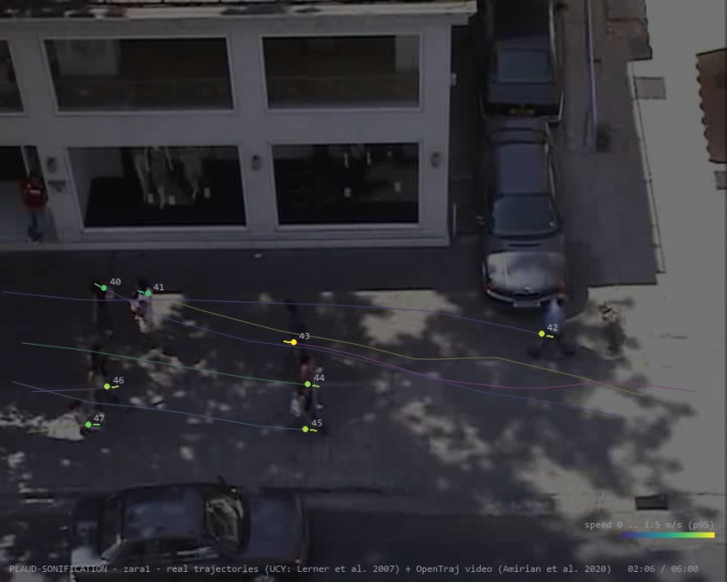

# PLAUD-SONIFICATION

Real collective movement, turned into sound. Recorded trajectories of crowds (pedestrians today,
animal groups next) are measured frame by frame (how many people, how fast and how orderly they
walk, how close they are, who arrives, who starts walking together) and these measures play
**PLAUD**, a neural (DDSP) synthesis model, together with a per-person granulator and a kick in
Max/MSP. Nobody plays notes: the crowd does.

**Demo video:** _coming soon_ <!-- add the link or a GIF here -->



*The zara1 scene (UCY, Lerner et al. 2007) over its original video (OpenTraj, Amirian et al. 2020).
Each dot is a recorded pedestrian, coloured by speed, with the last 10 s of its path.*

## How it works

```
 trajectory file: ETH/UCY pedestrians, or any CSV of positions (id, frame, x, y)
   |  metres -> screen, smooth motion at 60 fps (spline), per-dataset calibration
   v
 the people on screen, measured ~15 Hz
   |  descriptors (count, speed, agitation, centroid, spread, ...)
   |  scene quantities (count, speed, direction disorder, closeness, arrivals, pairs)
   v
 sound profile: synthfish (the fish school's mapping) or scene (the crowd's state)
   v
 OSC over UDP -> 127.0.0.1:7400
   v
 Max/MSP
   |- PLAUD (nn~)       style territory, loudness, centroid, partials (lim), stretch, latent L2
   |- max/shoal_fx      a kick (with reverb), optionally shaking PLAUD
   '- max/shoal_gran    each person is a grain voice, panned where they are; slices on arrivals
```

The picture shows the people on a metric map, on the scene's reference frame, or over the
original video. The full explanation, with every mapping, is in [docs/SYSTEM.md](docs/SYSTEM.md).

## Sound profiles

`--replay-profile` chooses how the crowd plays the sound.

- **`synthfish`** (default): the simulation's mapping, unchanged. The crowd's centroid steers
  PLAUD's style, the count sets its loudness and the grain density, agitation moves latent L2, and
  sudden accelerations in the data trigger the kick.
- **`scene`**: PLAUD follows the state of the scene within seconds, and every event you hear is
  something you can point at in the picture.

| In the scene | What you hear | OSC |
|---|---|---|
| how many people (relative to the file's own range), how fast they walk, how disordered their directions are | PLAUD's style: the territory cell of the model's terrain map whose onsets, rhythm and texture match best, gliding over ~4 s | `/plaud/x`, `/plaud/y` |
| how many people | PLAUD's loudness latent; more people, more partials | `/plaud/loudness`, `/plaud/limit` |
| how fast they walk | PLAUD's centroid latent | `/plaud/centroid` |
| how close they are to each other | tension: the spectrum stretches upward, the partials thin | `/plaud/stretch`, `/plaud/limit` |
| agitation | latent L2 | `/plaud/temp` |
| where each person is in the picture | the pan of their grain voice | `/gran/fish_x` |
| walking cadence | the grains pulse at the step rate | `/gran/density` |
| someone enters the picture | a slice of the grain source, by where they enter | `/pad/sample` |
| two people start walking together | one kick | `/pad/kick` |
| nobody on screen | silence | `/mix/master` |

In the scene profile every event flashes on its people at the same moment, and people at the very
edge of the picture make no sound. `/plaud/limit`, `/plaud/centroid` and `/plaud/stretch` need one
route in the PLAUD device: [docs/MAX_PATCH_CHANGES.md](docs/MAX_PATCH_CHANGES.md).

**zara1 is the main scene.** It is a two-way shopping street (UCY) with 1 to 10 people at once over
6 minutes, so arrivals and pairs are easy to follow. Its original video and a checked camera
alignment give the camera and video views, where the sound's pan matches the people. Most of the
movement you see in the video is annotated (about 77 %, against 28 % in hotel), and the walking
speeds are realistic (eth moves about twice too fast).

## Origin

PLAUD-SONIFICATION is built on **SynthFish** ([github.com/AleMurru/Musish](https://github.com/AleMurru/Musish)),
in which a flock of simulated fish performs PLAUD
([SynthFish demo video](https://youtu.be/3ueGfejkkj8)).
- SynthFish is by Simone Zanetti and Alessandro Murru, with the musician Rafael, who made the
  music, the live performance and the recordings PLAUD was trained on.
- It was made at the Generative Music AI Workshop (UPF / MTG with The Sound of AI), Barcelona,
  July 2026.
- **PLAUD** (Performative Latents for Adaptive Unsupervised DDSP) is by Błażej Kotowski.

This repository replaces the simulated fish with real trajectories. The fish simulation is still
available ([simulation mode](#simulation-mode-synthfish)).

## Quick start (Windows)

Needs Python 3.13 and Git. Max is optional: without it everything runs, and the OSC packets
simply go unanswered.

**1. Clone**

```
git clone https://github.com/SimoneZanetti00/PLAUD-SONIFICATION.git
cd PLAUD-SONIFICATION
```

**2. Create the Python environments.** The base one runs everything except the video view. The
video one adds OpenCV for the video view. You need only one of them.

```
python -m venv .venv
.venv\Scripts\activate
pip install -r requirements.txt
```

```
python -m venv .venv-video
.venv-video\Scripts\activate
pip install -r requirements-video.txt
```

**3. Get the data.** None of it is included. Download the ETH/UCY trajectory files, and for the
camera and video views the OpenTraj frames, homographies and videos, into any folder outside
the repository (called `<DATA>` below). Follow [docs/REPLAY.md, "Getting the files"](docs/REPLAY.md#getting-the-files).

**4. Run.** Replace `<DATA>` with your folder.

The main scene, zara1 over its original video, with the scene profile (video environment).
`<MODEL>` is the folder of the PLAUD model, whose terrain map `RafaelV2.json` comes with the model
(not included); without `--replay-terrain` the profile uses plain axes instead.

```
python src\main.py --replay <DATA>\eth_ucy\zara1\crowds_zara01.txt --replay-profile scene --replay-terrain <MODEL>\RafaelV2.json --replay-view video --replay-camera-dir <DATA>\opentraj
```

Other views, with the default profile:

```
:: map view (base or video environment)
python src\main.py --replay <DATA>\eth_ucy\zara1\crowds_zara01.txt --replay-flip-y

:: camera view: the people on the scene's reference frame
python src\main.py --replay <DATA>\eth_ucy\zara1\crowds_zara01.txt --replay-view camera --replay-camera-dir <DATA>\opentraj

:: video view (video environment): the people over the original video
python src\main.py --replay <DATA>\eth_ucy\hotel\biwi_hotel.txt --replay-view video --replay-camera-dir <DATA>\opentraj
```

To avoid repeating the folders, set them once with `set PLAUD_OPENTRAJ_DIR=<DATA>\opentraj` and
`set PLAUD_TERRAIN=<MODEL>\RafaelV2.json`.
Other scenes: `zara2`, `univ` (map view), `hotel`; the options are described in
[docs/REPLAY.md](docs/REPLAY.md#command-line).

### Simulation mode (SynthFish)

Without `--replay` the original fish simulation runs, unchanged: `python src\main.py`. It is played
with the mouse, the keyboard and an AKAI MPK mini 3 or MIDIMIX ([docs/CONTROLS.md](docs/CONTROLS.md)).

## Max setup

The sound is made in Max 9:
- the **PLAUD device** with its trained model (`nn~`) receives `/plaud/*`;
- `max/shoal_fx.maxpat` receives `/fx/*` (the kick and the shake);
- `max/shoal_gran.maxpat` receives `/gran/*` (one grain voice per person).

**Not included:** the PLAUD device, the PLAUD model and all audio. Put your own `shoal_kick.wav`
and `shoal_gran.aiff` next to the patches.

The routes and the edits to the PLAUD device are in [docs/MAX_SETUP.md](docs/MAX_SETUP.md), and
the route this project added for the scene profile is in
[docs/MAX_PATCH_CHANGES.md](docs/MAX_PATCH_CHANGES.md). Every OSC address, including what changes
in replay mode, is in [docs/OSC.md](docs/OSC.md).

## Controls (replay mode)

| Input | Effect |
|---|---|
| `SPACE` | pause / resume the data (and the video) |
| `R` | restart the file |
| `H` | HUD on / off: scene, source, data time, people on screen, events, descriptors, sound profile values |
| `I` | track id labels on / off |
| `N` / `L` / `V` | social graph / long exposure / video look (normal, dark, off) |
| mouse left / right | draw food / predator rings; the predator still triggers the kick in Max. Nobody moves |
| `F11` | fullscreen on / off |
| `ESC` | quit |

MIDI is off in replay mode; the UDP control port 7500 stays open. All keys, both modes and the
MIDI controllers are in [docs/CONTROLS.md](docs/CONTROLS.md).

## Repository layout

```
requirements.txt        pinned Python dependencies (pygame, python-osc)
requirements-video.txt  optional: adds OpenCV for the video view
src/
  main.py               entry point: command line, window, main loop, inputs
  aquarium_boids/       simulation and replay sources, descriptors, OSC, MIDI, rendering
    replay/             trajectory loader, interpolation, calibration, events, camera, video
  tools/                send_control_test.py (test controls on UDP 7500)
max/
  shoal_fx.maxpat       predator / event kick + spectral shake + reverb
  shoal_gran.maxpat     per-person granulator, slice player, source menu
docs/                   SYSTEM, REPLAY, ARCHITECTURE, OSC, CONTROLS, MAX_SETUP, MAX_PATCH_CHANGES, ROADMAP, IDEAS; img/
tests/                  offline tests: python -m unittest discover -s tests
```

## Documentation

| Page | Contents |
|---|---|
| [docs/SYSTEM.md](docs/SYSTEM.md) | how the whole system works: pipeline, scene quantities, both sound profiles as mapping tables, the terrain map, events, the Max patches, limits |
| [docs/REPLAY.md](docs/REPLAY.md) | data sources and citations, getting the files, every replay option, views, calibration, events, known limits |
| [docs/ARCHITECTURE.md](docs/ARCHITECTURE.md) | modules, the frame loop, simulation vs replay source, descriptors, how they reach the sound |
| [docs/OSC.md](docs/OSC.md) | every OSC address with its range, replay-mode differences, the control input on UDP 7500 |
| [docs/CONTROLS.md](docs/CONTROLS.md) | keyboard, mouse, command line, replay mode, MPK mini 3, MIDIMIX |
| [docs/MAX_SETUP.md](docs/MAX_SETUP.md) | the PLAUD device routes, the prior~ edits, the `shoal_fx` and `shoal_gran` patches |
| [docs/MAX_PATCH_CHANGES.md](docs/MAX_PATCH_CHANGES.md) | every object and route this project added to the PLAUD device, and how to add them by hand |
| [docs/ROADMAP.md](docs/ROADMAP.md) | where the project goes next: finishing the pedestrian piece, public release, new datasets, new PLAUD models, artistic and visual work |
| [docs/IDEAS.md](docs/IDEAS.md) | ideas and future work from the SynthFish phase |

## Data sources and citations

The datasets are **not redistributed** here. Get them from their sources and cite them when you use
this project:
- **UCY** (zara1, zara2, univ): A. Lerner, Y. Chrysanthou, D. Lischinski, *Crowds by Example*,
  Computer Graphics Forum, 2007.
- **ETH** (eth, hotel): S. Pellegrini, A. Ess, K. Schindler, L. van Gool, *You'll never walk alone*,
  ICCV 2009.
- **Trajectory files:** the Social GAN splits as distributed by Trajectron++.
- **Reference frames, homographies and videos:** OpenTraj (J. Amirian et al., ACCV 2020).

Terms, pinned versions and the full references: [docs/REPLAY.md, "Data sources and citations"](docs/REPLAY.md#data-sources-and-citations).
The screenshot above contains a frame of the UCY zara01 video, shown with its credit.

## Status and next steps

**Working:**
- pedestrian replay from ETH/UCY and from any CSV, on Windows, at 60 fps with up to 100 people;
- per-dataset calibration, so `mean_speed` and agitation mean the same 0–1 in every scene;
- acceleration events that trigger the kick;
- the scene sound profile, with events that flash on the people who make them;
- map, camera and video views;
- the original fish simulation, unchanged.

**Known limits** (details in [docs/REPLAY.md](docs/REPLAY.md#known-limits)):
- the `eth` scene moves about twice too fast;
- zara1 needs an image correction in the camera and video views;
- camera and video views exist for zara1 and hotel only;
- tested on Windows only.

**Next:**
- PLAUD's prior (cfg, temperature, smoothing) and latent looper driven by the scene, e.g. people
  walking together; this needs more routes in the PLAUD device;
- animal datasets (fish schools, bird flocks, insects), with their own calibration;
- our own recordings, tracked from video;
- Max presets per dataset.

The full plan, in order, is in [docs/ROADMAP.md](docs/ROADMAP.md).

## Credits

- Simone Zanetti and Alessandro Murru (system design and development); Rafael (music, live
  performance, training recordings). SynthFish: [github.com/AleMurru/Musish](https://github.com/AleMurru/Musish).
- PLAUD (Performative Latents for Adaptive Unsupervised DDSP) by Błażej Kotowski.
- Data: the ETH and UCY authors, Trajectron++ and OpenTraj (see above).

## License

To be agreed with co-authors.
